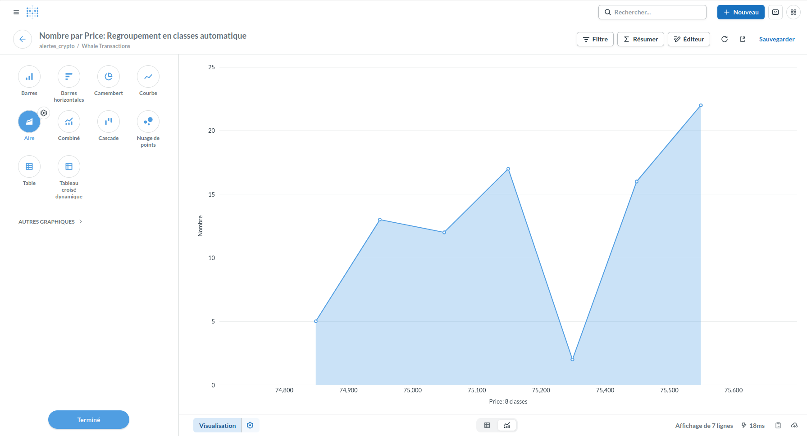
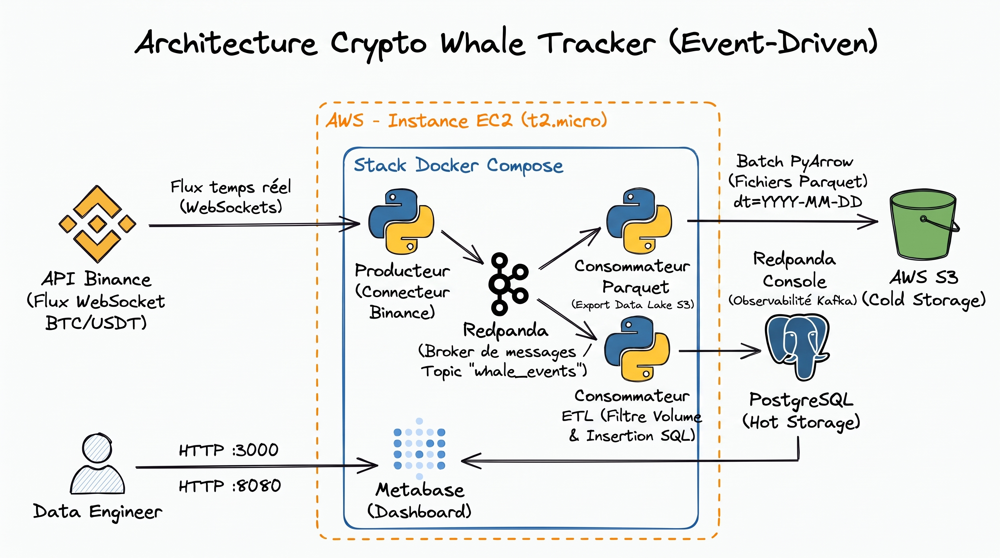

# 🐋 Crypto Whale Tracker - Real-Time ETL Pipeline

Ce projet est un pipeline de données (ETL) robuste, asynchrone et conteneurisé. Il est conçu pour ingérer un flux continu de transactions en temps réel depuis l'API WebSocket de Binance, détecter les mouvements institutionnels majeurs ("Baleines" ou Smart Money), et stocker ces données pour une visualisation instantanée.

L'infrastructure est provisionnée dynamiquement sur AWS via Terraform, et le déploiement est automatisé par un pipeline CI/CD GitHub Actions.

---

## 📊 Dashboard & Métriques en Production

>

**Performances du Pipeline :**
- **Débit d'ingestion :** ~ 80 messages traités par seconde.
- **Latence (Bout-en-bout) :** ~ 233 millisecondes entre l'ordre Binance et l'insertion PostgreSQL.
- **Volume identifié :** 6000 transactions exceptionnelles détectées sur 7 jours.

## 🏗️ Architecture du Système Event-Driven

L'architecture abandonne les requêtes HTTP synchrones classiques au profit d'une connexion WebSocket et d'un broker de messages pour garantir un véritable temps réel et une résilience totale (découplage).

1. **Extract (Producteur Python) :** Connexion asynchrone au flux public de Binance (Paire BTC/USDT) avec stratégie de reconnexion automatique (Exponential Backoff). Les données brutes sont captées et publiées instantanément.
2. **Message Broker (Redpanda / Kafka-compatible) :** Agit comme un tampon haute performance. Il découple l'ingestion de l'écriture en base, garantissant qu'aucun message n'est perdu même en cas de pic de volatilité (High Throughput).
3. **Transform & Load (Hot Storage - PostgreSQL) :** Un consommateur Python dédié lit le flux Kafka en temps réel, filtre les transactions majeures (Smart Money), et les insère dans PostgreSQL. La contrainte d'unicité sur le `trade_id` (`ON CONFLICT DO NOTHING`) garantit l'absence de doublons.
4. **Transform & Load (Cold Storage - S3) :** Un second consommateur indépendant lit le même topic Kafka, aggrège les données en RAM (flush régulier), les compresse au format **Parquet** via PyArrow, et les envoie vers un Data Lake AWS S3 avec partitionnement par date (`dt=YYYY-MM-DD`).
5. **Dataviz (Metabase) :** Tableau de bord branché sur PostgreSQL.
6. **Infrastructure (AWS) :** Déploiement automatisé sur EC2 (Zero-Touch Provisioning via Terraform et GitHub Actions).

